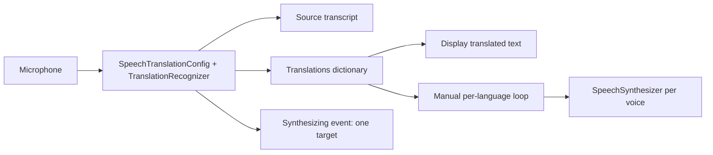

# M3_07 · Azure Speech Translation

## 1. Learning objective

Compare speech-to-text translation, Speech translation with event-based spoken output, and manual synthesis for multiple target languages.

## 2–4. Problem, concepts, architecture

A multilingual receptionist needs to understand one spoken request and either read or speak it in another language. Speech Translation performs recognition and translation as one managed Speech operation. Event-based synthesis also returns synthesized audio for one target language. For multiple spoken languages, translate to all target languages and synthesize each result separately.



## 5–9. Azure resources, prerequisites, authentication, SDK

Use an Azure AI Speech resource in a supported region. These scripts use the Speech resource key and region with `azure-cognitiveservices-speech` (Python Speech SDK); they do not use a Foundry project endpoint. Microphone access and a supported voice for the target language are needed. See [Speech translation documentation](https://learn.microsoft.com/azure/ai-services/speech-service/how-to-translate-speech?pivots=programming-language-python).

```powershell
python -m pip install -r demos/m3/07-azure-speech-translation/requirements.txt
```

Set `AZURE_SPEECH_KEY` and `AZURE_SPEECH_REGION` in the repository root `.env` (the local `.env.example` is a reference only).

## 10–12. Walkthrough, execution, expected output

Run each from the repository root:

```powershell
python demos/m3/07-azure-speech-translation/speech_to_text_translation.py
python demos/m3/07-azure-speech-translation/event_based_synthesis.py
python demos/m3/07-azure-speech-translation/manual_synthesis.py
```

Start with `en-US` to `hi,fr` speech-to-text. Then demonstrate event synthesis to `fr` with `fr-FR-DeniseNeural`; finally choose `hi,fr` for manual synthesis. Expected results include the recognized source transcript, a translation for each requested code, and files under `audio/` for synthesis. Audio generation uses real Azure requests; no fake mode is included.

The recognizer receives one short microphone utterance. For file-based repeats use existing M3_05 or adapt its `AudioConfig(filename=...)` pattern.

## 13–16. Trainer script, questions, mistakes, troubleshooting

Say: “Speech Translation gives us a transcript and a translation dictionary. Now we attach a voice to exactly one target and observe the `synthesizing` event. If we need Hindi and French audio, synthesize both separately from the translated text.”

Ask students: Which component recognizes speech? Why does the event workflow permit one target? Which stage can fail independently in manual synthesis?

See [troubleshooting.md](troubleshooting.md). Common problems are unsupported target codes, a voice whose language does not match the target, blocked microphone access, and Speech key/region mismatch. The event gives `event.result.audio` bytes in multiple chunks; this sample saves them as returned. Do not log keys or record personal data.

## 17–19. Security, limitations, exam takeaways

Speech SDK key auth is used for clarity in this lab; production can use Microsoft Entra ID where supported by the selected Speech resource and SDK. Restrict keys, rotate exposed keys, and use synthetic utterances. Recognition is not guaranteed; review translations before consequential use. Event-based synthesis supports one target language in this workflow. Manual synthesis makes target voice and output handling explicit.

Exam takeaway: distinguish translation from transliteration, understand `SpeechTranslationConfig`, `TranslationRecognizer`, `translations`, and the synthesizing event; handle `NoMatch` and `Canceled` explicitly.

## 20. Microsoft Learn references

- [Translate speech with the Speech SDK](https://learn.microsoft.com/azure/ai-services/speech-service/how-to-translate-speech?pivots=programming-language-python)
- [Speech SDK for Python](https://learn.microsoft.com/azure/ai-services/speech-service/quickstarts/setup-platform)
