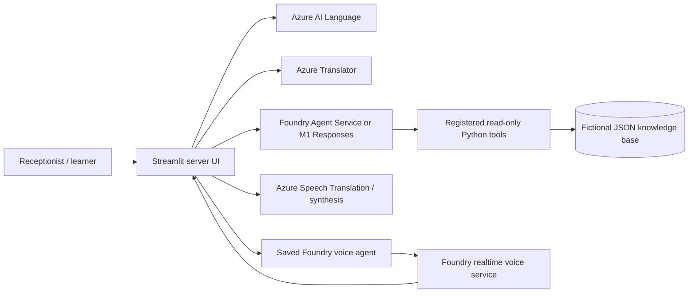
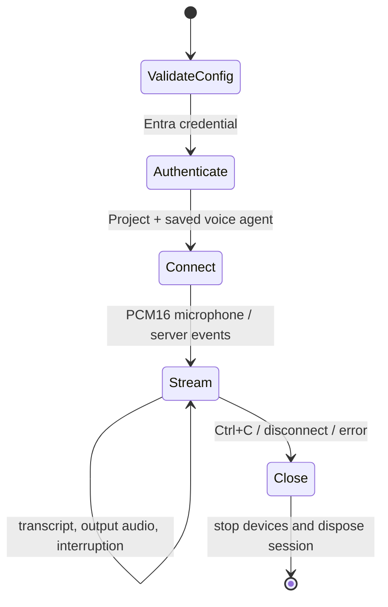
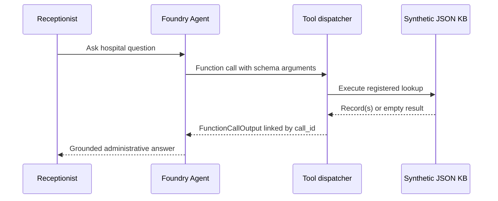
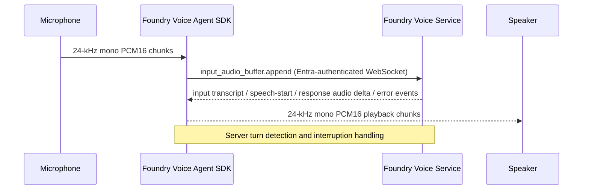
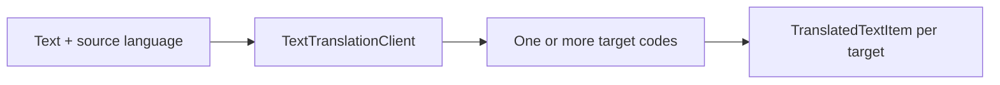
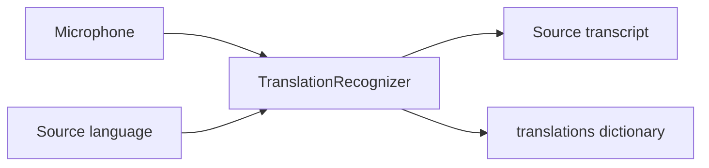
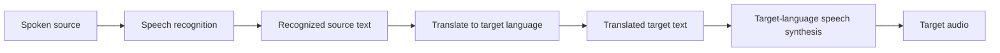
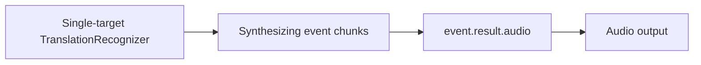
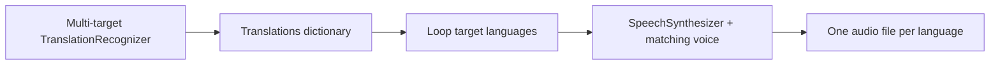

# GlobalCare AI architecture

Voice Agent session lifecycle:

The JSON knowledge base is the only source of hospital facts. Tool outputs are returned to a model for phrasing, but the instructions require it to state when data is missing. Tool traces record only calls that the Python dispatcher actually executed.

Text Translation follows `TextTranslationClient.translate`; supported languages are requested with `get_supported_languages` and should be cached by the application. Transliteration changes script while preserving a language's spoken form (for example kana to Latin), whereas translation changes meaning into another language.

Speech-to-text translation:

Speech-to-speech translation composes the text translation with speech output:

Event-based speech output:

Manual multi-language speech output:

The foundry model endpoint, Foundry project endpoint, Speech resource region/endpoint, Translator global endpoint and Voice Agent project's realtime endpoint serve different APIs and must not be substituted for each other.
